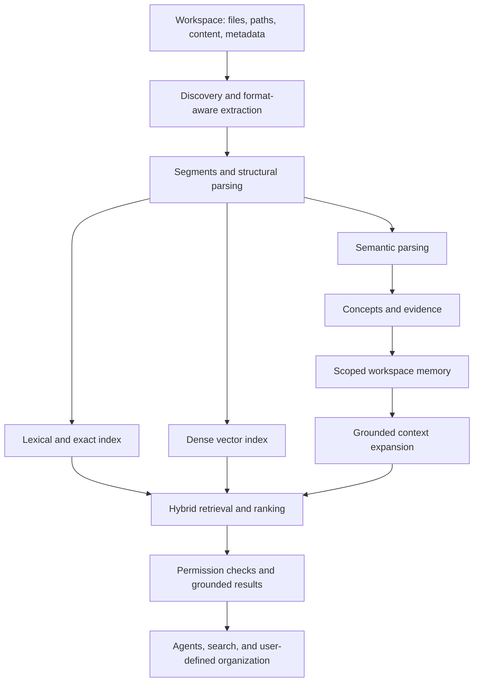

# Lexmoryn

**Workspace-aware semantic understanding, memory, and retrieval for heterogeneous files.**

> **Status: research proposal / pre-implementation.** Lexmoryn does not yet ship a trained model, benchmark results, CLI, or production-ready search engine. The documents in this repository define hypotheses and a testable research agenda, not verified capabilities.

Lexmoryn explores whether a lightweight multilingual semantic model, combined with evidence-grounded workspace memory, can make unstructured files easier to understand, connect, and retrieve.

The inputs are **not restricted to documents or filenames**: a workspace may contain source code, configuration, logs, spreadsheets, PDFs, media metadata, and text extracted from other formats. Extractors provide the model with filename/path signals, content segments, metadata, and relationships. Non-text media would require appropriate optional extractors or multimodal models.

## The idea

A filename such as `backup_prod_db_2026_11_18.sql` might yield normalized concepts such as `backup`, `production`, `database`, and `2026-11-18`. In a separate workspace, a name like `EagleService.cs` may refer to an internal payment service, not a bird. Lexmoryn should learn that *local* interpretation from evidence in source code, documentation, and links — without silently turning a guess into fact.

**The core model describes meaning; the application decides what to do with it.** Renaming, path organization, classification, and agent search are optional downstream uses, not model-generated side effects.

## Proposed capabilities (not implemented)

- **Semantic parsing:** recognize meaningful spans in short, noisy names and longer text.
- **Open-vocabulary concepts:** preserve novel terms and identifiers rather than forcing every span into a closed label set.
- **Evidence-grounded workspace adaptation:** discover aliases, entities, and relationships that are specific to a repository or folder.
- **Context-aware retrieval:** combine lexical/exact search, dense representations, structural signals, and optional graph-based expansion.
- **Cross-format extensibility:** adapters for source code, plain text, structured data, documents, and media-derived text/metadata.
- **Developer-owned output:** return a structured representation with provenance, uncertainty, and unresolved spans; let callers format names or consume search results.

## Research architecture



A pretrained model and a workspace's learned knowledge are **different artifacts**. Workspace memory should be rebuildable and isolated per workspace; discovering a new alias should not require fine-tuning model weights.

## Example target representation

*Illustrative proposed schema; not actual model inference:*

```json
{
  "schema_version": "0.1-draft",
  "workspace_id": "example-workspace",
  "source": {
    "path": "src/EagleService.cs",
    "kind": "source_code"
  },
  "concepts": [
    {
      "surface": "Eagle",
      "canonical": "payment_processing_service",
      "role": "workspace_alias",
      "confidence": null,
      "status": "inferred",
      "evidence": ["docs/architecture.md"]
    }
  ],
  "unresolved": []
}
```

`confidence: null` is intentional: numeric confidence should not be presented until calibration has been evaluated. A claim must always remain traceable to its originating source.

## What makes this a research question?

Lexmoryn is **not** claiming to have invented semantic search, knowledge graphs, information extraction, or contextual retrieval. Related techniques already exist. The hypothesis is that **specialized short-text parsing plus local evidence-grounded context** can improve retrieval quality and efficiency on heterogeneous workspaces compared with strong existing baselines.

The project will first establish a dataset and reproducible benchmarks. **No custom model should be published solely because we can fine-tune one.**

## Documentation

- [White paper — research proposal](docs/WHITEPAPER.md)
- [System architecture](docs/ARCHITECTURE.md)
- [Semantic output contract](docs/SEMANTIC_SCHEMA.md)
- [Research and evaluation plan](docs/RESEARCH_PLAN.md)

## First milestones

1. Define a versioned semantic schema, annotation guidelines, and data governance rules.
2. Build a multi-language, multi-format evaluation set with a held-out workspace split.
3. Benchmark exact search/BM25, general-purpose embeddings, and hybrid retrieval.
4. Prototype semantic parsing and local concept/alias memory; perform ablations.
5. Consider training or distilling a small specialized model **only if measured gains justify it**.

## Principles

- **Local-first and privacy-conscious:** no implicit external upload of workspace content.
- **Evidence over invention:** uncertain relationships remain hypotheses until verified.
- **Exact identifiers matter:** versions, hashes, IDs, and paths cannot be collapsed by semantic similarity.
- **Incremental by design:** update changed files and retract stale claims.
- **Transparent benchmarking:** publish baselines, failure cases, latency, and cost alongside accuracy.
- **International by default:** Unicode, mixed scripts, multilingual data, and language-neutral core concepts.

## Project stage and contributions

This repository currently contains design documents, not a runnable package. Contributions are welcome as discussions, datasets that can legally be shared, benchmark ideas, and falsifiable research questions.

**Licensing:** A code/model/data license has not yet been selected. Do not assume the repository contents, future model weights, and future datasets have identical redistribution rights.

---
*Lexmoryn — Understand the workspace. Retrieve with context.*
